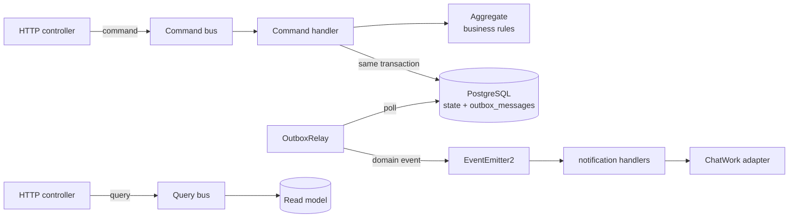

# Event System — Backend

[](https://github.com/bangnk2000/event-system-be/actions/workflows/ci.yml)


A backend for managing a company's internal events: event lifecycle, registrations and check-in, budgets,
post-event surveys, sports tournaments and chat notifications.
It is a personal project modelled on a real company use case, built to practise **Hexagonal Architecture, DDD
and reliable event publishing** on a codebase that is large enough for those patterns to matter.

> 🇻🇳 Vietnamese version: [README.vi.md](README.vi.md). The requirements (SRS), the per-aggregate design docs and the
> session logs in [`docs/`](docs/) are written in Vietnamese.

## Highlights

- **6 bounded contexts** (`event`, `participation`, `budget`, `notification`, `survey`, `competition`), each cut
  through all four layers: Interface → Application → Domain → Infrastructure.
- **A pure domain layer** with no framework, I/O or SDK imports. Business rules live in aggregates and value objects
  (for example `Money` in `budget`).
- **Lightweight CQRS** on one PostgreSQL database. Commands go through aggregates; queries read straight from read models.
- **Transactional outbox.** Domain events are written to `outbox_messages` in the same transaction as the state change,
  then an `OutboxRelay` publishes them, so a crash cannot lose an event or send one for a change that rolled back.
- **No cross-module imports.** Contexts talk only through command/query contracts (`src/libs/contracts/`) or domain
  events. The rule is **enforced in CI** by dependency-cruiser and ESLint boundaries, not just written down.
- **Design first.** The SRS and a design doc for every aggregate (invariants, state transitions) were written
  before the code. See [`docs/design/`](docs/design/).
- **Built with AI coding agents under explicit rules.** [`AGENTS.md`](AGENTS.md) sets the architecture rules and
  workflow for agents. The CI gates below are what keeps their output honest.

## Architecture



| Context | Role | Aggregate | What it does |
|---|---|---|---|
| **event** | Core | `Event` | Create, publish, open registration, reschedule, cancel, summary report |
| **participation** | Core | `Registration` | Individual/team registration, check-in, cancellation, statistics |
| **budget** | Supporting | `Budget` (+ `BudgetItem`, VO `Money`) | Planned vs. actual spending, closing the books |
| **notification** | Supporting | `NotificationPreference` | User preferences, reacts to domain events and sends chat messages |
| **survey** | Supporting | `Survey`, `SurveyResponse` | Anonymous post-event surveys (only an HMAC token is stored, never the respondent) |
| **competition** | Supporting | `Tournament` (+ `Competitor`, `Match`) | Knockout, round-robin, and group stage → knockout tournaments |

## Quality gates (every PR, see [`.github/workflows/`](.github/workflows/))

| Gate | Command |
|---|---|
| Type check | `pnpm typecheck` |
| Architecture rules: pure domain, module privacy | `pnpm arch` (dependency-cruiser) |
| Architecture map is up to date | `pnpm map:check` → [`docs/architecture-map.md`](docs/architecture-map.md) |
| OpenAPI spec is up to date | `pnpm openapi:check` → [`docs/openapi.json`](docs/openapi.json) |
| Lint, including layer boundaries | `pnpm lint` |
| Unit tests with a coverage gate on the domain layer | `pnpm test:cov` |
| End-to-end tests over HTTP against a real PostgreSQL | `pnpm test:e2e` (28 tests in 7 files) |

## Tech stack

NestJS 11 (`@nestjs/cqrs`, `@nestjs/event-emitter`, `@nestjs/schedule`, `@nestjs/swagger`) · TypeScript 5.7 ·
TypeORM + PostgreSQL 16 · zod (config validation) · pino logging · Google ID-token auth (`google-auth-library`) ·
Jest + supertest · dependency-cruiser · ESLint · Husky · GitHub Actions · Docker Compose

## Run it locally

Requirements: Node ≥ 20 (22 LTS recommended), pnpm, Docker.

```bash
pnpm install
cp .env.example .env
docker compose up -d      # PostgreSQL 16 on :5432
pnpm migration:run
pnpm start:dev            # http://localhost:3000 (Swagger UI in dev)
```

Try it:

```bash
# Create an event. Without GOOGLE_CLIENT_ID the API accepts an x-user-id header as a dev fallback.
curl -X POST http://localhost:3000/v1/events \
  -H 'Content-Type: application/json' -H 'x-user-id: 11111111-1111-1111-1111-111111111111' \
  -d '{"titleVi":"Company all-hands","type":"INTERNAL_MEETING",
       "startAt":"2026-07-10T02:00:00.000Z","endAt":"2026-07-10T04:00:00.000Z",
       "registrationMode":"INDIVIDUAL"}'

curl 'http://localhost:3000/v1/events?lang=vi'
```

[`api.http`](api.http) contains a chained set of requests for the full event → registration → budget flow
(VS Code REST Client or the JetBrains HTTP client).

## API overview (base path `/v1`)

Auth: `Authorization: Bearer <google-id-token>` when `GOOGLE_CLIENT_ID` is set, otherwise the `x-user-id` dev header.

- **Event**: `POST /events` · `GET /events` · `POST /events/:id/publish` · `POST /events/:id/open-registration` · `PATCH /events/:id/schedule` · `POST /events/:id/cancel` · `GET /events/:eventId/report`
- **Participation**: `POST|GET /events/:eventId/registrations` · `POST /registrations/:id/check-in` · `POST /registrations/:id/cancel`
- **Budget**: `POST|GET /events/:eventId/budget` · `POST /budgets/:budgetId/items` · `PATCH /budgets/:budgetId/items/:itemId/actual` · `POST /budgets/:budgetId/finalize`
- **Notification**: `PUT|GET /notification-preferences`
- **Survey**: `POST|GET /events/:eventId/surveys` · `GET /surveys/:surveyId` · `GET /surveys/:surveyId/results` · `POST /surveys/:surveyId/open|close` · `POST /surveys/:surveyId/responses`
- **Competition**: `POST|GET /events/:eventId/tournaments` · `POST /tournaments/:id/seed` · `POST|DELETE /tournaments/:id/competitors[/:competitorId]` · `POST /tournaments/:id/advance-knockout` · `POST /tournaments/:id/matches/:matchId/result` · `POST /tournaments/:id/complete` · `GET /tournaments/:id` · `GET /tournaments/:id/standings`

The full spec is in [`docs/openapi.json`](docs/openapi.json).

## What's next

Production hardening for Google SSO, full i18n, real ChatWork/Calendar/Drive adapters (stubbed when the
environment variables are not set), and a check that an event exists when someone registers for it.
